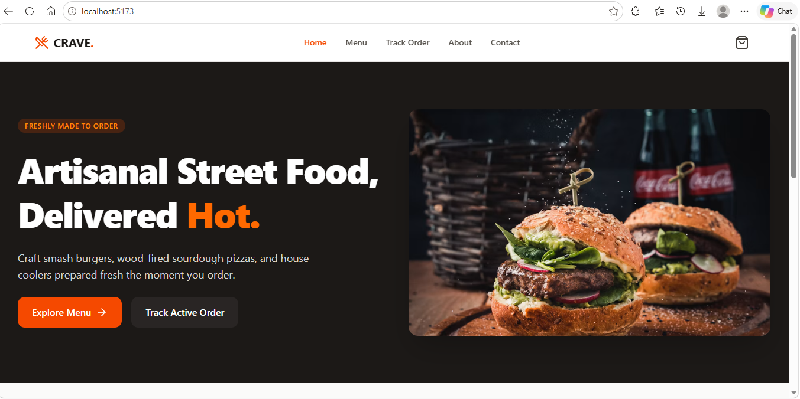
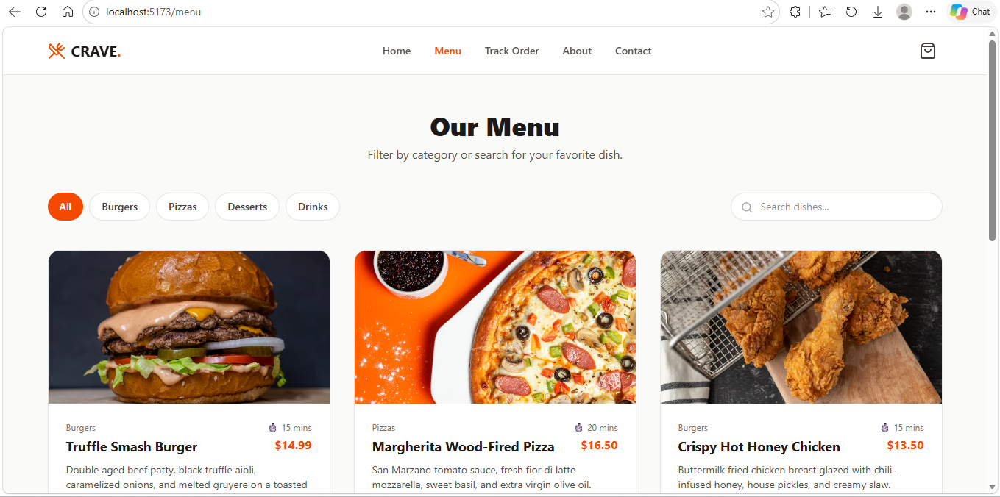
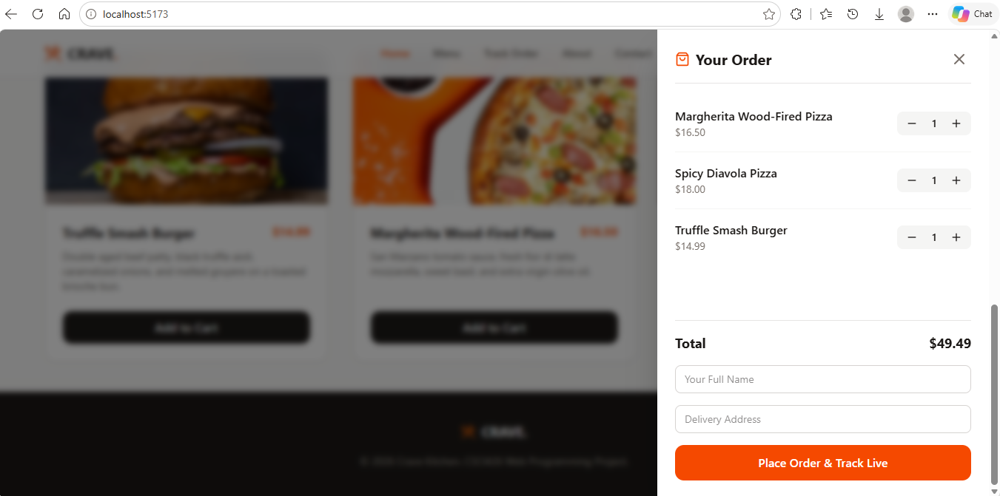
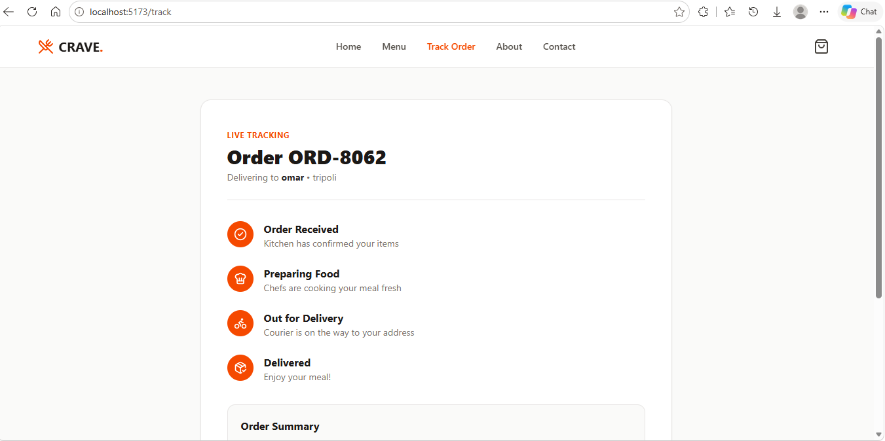

# CRAVE. — Restaurant Ordering System

**Course:** CSCI426: Advanced Web Programming (Project Phase 1)  
**Student:** Omar Halawani (52330594)  
**Theme:** Restaurant Ordering System — Menu display, cart, and order tracking  
---

## Project Description
**CRAVE.** is a modern, responsive frontend web application built with ReactJS and Tailwind CSS. It simulates a complete restaurant ordering experience, enabling users to browse signature dishes, filter and search the menu by category, manage items in a live slide-over shopping cart, and track their order status in real time from kitchen preparation to delivery.

### Key Features
- **5 Responsive Pages:** Home, Menu, Live Order Tracker (Dynamic Page), About, and Contact.
- **Interactive Menu Filtering:** Filter dishes by category (*Burgers, Pizzas, Desserts, Drinks*) and search in real time.
- **Global Cart State Management:** Add items, adjust quantities, calculate totals dynamically, and submit delivery details via a slide-over cart drawer.
- **Dynamic Order Tracking:** Real-time order status stepper (*Order Received → Preparing Food → Out for Delivery → Delivered*) with interactive stage simulation.
- **Mobile-First Responsive UI:** Adaptive navigation bar with mobile menu drawer and responsive grid layouts.

---

## Technologies Used
- **ReactJS (v19)** with **Vite**
- **React Router DOM** (Client-side routing across pages)
- **Tailwind CSS** (Responsive styling and layout)
- **Lucide React** (UI icons)
- **Git & GitHub** (Version control)
- **Vercel** (Frontend deployment)

---
## UI Screenshots

### Home Page


### Interactive Menu


### Slide-Over Shopping Cart & Checkout


### Live Order Tracker (Dynamic Page)

   
## Setup Instructions
Follow these steps to run the project locally:

1. **Clone the repository:**
   ```bash
   git clone [https://github.com/52330594/crave-restaurant-app-.git](https://github.com/52330594/crave-restaurant-app-.git)
   ---
cd crave-restaurant-app-
